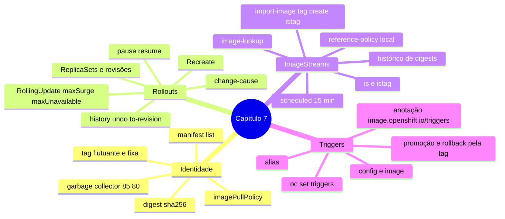

# Resumo — Capítulo 7

Síntese autoral para revisão rápida. Correspondência oficial: seção 7.10 (PDF p. 494).

## Em uma frase por seção

| Seção | Ideia central |
|-------|---------------|
| 7.1 | Tags flutuantes mudam sem aviso; o digest é imutável; `imagePullPolicy` controla quando o nó consulta o registry; o garbage collector limpa imagens antigas |
| 7.3 | Deployments trocam versões por RollingUpdate (sem indisponibilidade, com readiness) ou Recreate; cada mudança cria um ReplicaSet; pause/resume, history e undo controlam rollouts |
| 7.5 | ImageStreams dão nomes curtos estáveis, digest congelado e histórico; `--scheduled` e pull-through são opcionais; Deployments as usam com lookup local |
| 7.7 | Image triggers fazem o Deployment seguir uma ImageStreamTag; aliases permitem promover e reverter movendo a tag |

## Mapa do capítulo

## Tabela de comandos do capítulo

| Tarefa | Comando |
|--------|---------|
| Digest de uma tag | `oc image info [--filter-by-os linux/amd64] ` · `skopeo inspect docker://` |
| Imagens no nó | `crictl images --digests --no-trunc` · `crictl imagefsinfo` |
| Digest em execução | `oc get pod 
 -o jsonpath='{.status.containerStatuses[*].imageID}'` |
| Trocar imagem | `oc set image deployment/<d> <container>=` |
| Agrupar mudanças | `oc rollout pause deployment/<d>` … `oc rollout resume deployment/<d>` |
| Acompanhar | `oc rollout status deployment/<d>` · `oc get rs` |
| Histórico | `oc rollout history deployment/<d> [--revision N]` |
| Rollback | `oc rollout undo deployment/<d> [--to-revision N]` |
| Motivo da revisão | `oc annotate deployment/<d> kubernetes.io/change-cause="..." --overwrite` |
| Criar/atualizar istag | `oc import-image <is:tag> --from  --confirm` · `oc tag  <is:tag>` |
| Só criar istag | `oc create istag <is:tag> --from-image ` |
| Agendar / cache | `oc tag  <is:tag> --scheduled` · `--reference-policy local` |
| Lookup local | `oc set image-lookup <is>` · `oc set image-lookup` (listar) |
| Inspecionar | `oc describe is <is>` · `oc get istag` |
| Trigger | `oc set triggers deployment/<d> --from-image <is:tag> --containers <c>` |
| Ver / ligar / desligar | `oc set triggers deployment/<d>` · `--auto` · `--manual` · `--remove-all` |
| Alias | `oc tag --alias <is:origem> <is:alias>` |

## Alertas operacionais

- ⚠️ `latest` em produção: versões misturadas e rollbacks imprevisíveis.
- ⚠️ IMAGE ID do `crictl` não é o digest.
- ⚠️ Não limpe imagens com `crictl rmi`; ajuste o garbage collector por `KubeletConfig`.
- ⚠️ Sem readiness, o RollingUpdate gera erros para clientes.
- ⚠️ Rollout com falha não se reverte sozinho.
- ⚠️ Não edite nem apague ReplicaSets diretamente.
- ⚠️ Com image trigger, faça rollback pela tag.

## Ligação com o próximo capítulo

O Capítulo 8 é a **revisão integrada** do curso: implantar, expor, configurar,
diagnosticar e escalar aplicações usando tudo o que foi visto nos capítulos 1 a 7.

---
[← Revisão](REVISAO.md) | [Índice do capítulo](README.md) | [Próximo capítulo →](../08-revisao-geral/README.md)
