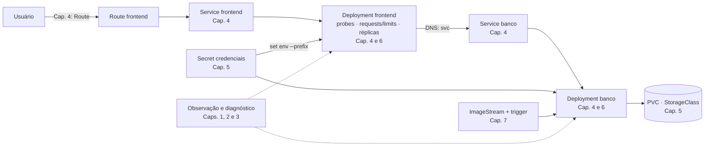

# 8.1 — Resumo dos objetivos de aprendizagem

| Campo | Valor |
|-------|-------|
| Curso | DO180 — OpenShift 4.22 |
| Capítulo / seção | Capítulo 8 · Seção 8.1 |
| Título original | Summary of Learning Objectives |
| Título em português | Resumo dos objetivos de aprendizagem |
| Objetivo | Revisar, de forma integrada, os conhecimentos e habilidades dos capítulos 1 a 7 antes dos laboratórios de revisão |
| Pré-requisitos | Capítulos 1 a 7 concluídos |
| Referência | PDF p. 496–497 · Labs 8.2 (p. 498–506) e 8.3 (p. 507–512) |

> O curso apresenta o Capítulo 8 como apoio para quem se prepara para os exames
> **EX180** e **EX280**. Esta lição é um **roteiro autoral** de revisão integrada,
> não uma cópia da lista oficial.

## Parte A — Entendendo o conceito

### O ciclo de vida que o DO180 ensina

Os sete capítulos formam uma única história: **observar** o cluster, **rodar**
containers, **implantar e expor** aplicações, **configurá-las e dar-lhes dados**,
torná-las **confiáveis** e **atualizá-las** com segurança. Os labs de revisão cobram
essa história de ponta a ponta, por **especificação**, sem passo a passo e **com
tempo limitado**.

| Fase | Capítulo | Você precisa saber... | Lições |
|------|----------|-----------------------|--------|
| Observar | 1 | Componentes do cluster; navegar e monitorar pela console | [1.1](../01-introducao-kubernetes-openshift/1.1-containers-e-kubernetes.md) · [1.3](../01-introducao-kubernetes-openshift/1.3-componentes-e-edicoes-do-openshift.md) · [1.5](../01-introducao-kubernetes-openshift/1.5-navegar-na-web-console.md) · [1.7](../01-introducao-kubernetes-openshift/1.7-monitorar-um-cluster-openshift.md) |
| Operar pela CLI | 2 | Login, projetos, `api-resources`, `explain`, filtros, saúde do cluster | [2.1](../02-cli-e-apis/2.1-interfaces-de-linha-de-comando.md) · [2.3](../02-cli-e-apis/2.3-inspecionar-recursos-kubernetes.md) · [2.5](../02-cli-e-apis/2.5-avaliar-a-saude-do-cluster.md) |
| Rodar e diagnosticar | 3 | Pods, UIDs, imagens, `skopeo`, `logs`/`exec`/`cp`/`port-forward` | [3.1](../03-containers-e-pods/3.1-criar-containers-e-pods.md) · [3.3](../03-containers-e-pods/3.3-encontrar-e-inspecionar-imagens.md) · [3.5](../03-containers-e-pods/3.5-diagnosticar-containers-e-pods.md) |
| Implantar e expor | 4 | Deployments, Jobs, Services, DNS, Routes, Ingress, escala | [4.1](../04-deploy-e-redes/4.1-implantar-a-partir-de-imagem-e-template.md) · [4.3](../04-deploy-e-redes/4.3-workloads-de-longa-e-curta-duracao.md) · [4.5](../04-deploy-e-redes/4.5-redes-de-pods-e-services.md) · [4.7](../04-deploy-e-redes/4.7-escalar-e-expor-aplicacoes.md) |
| Configurar e persistir | 5 | ConfigMaps, Secrets, PVCs, StorageClasses, StatefulSets | [5.1](../05-configuracao-e-storage/5.1-externalizar-configuracao.md) · [5.3](../05-configuracao-e-storage/5.3-provisionar-volumes-persistentes.md) · [5.5](../05-configuracao-e-storage/5.5-selecionar-storage-class.md) · [5.7](../05-configuracao-e-storage/5.7-storage-nao-compartilhado-com-statefulsets.md) |
| Tornar confiável | 6 | Probes, requests, limits, HPA | [6.1](../06-confiabilidade/6.1-alta-disponibilidade-de-aplicacoes.md) · [6.3](../06-confiabilidade/6.3-health-probes.md) · [6.5](../06-confiabilidade/6.5-reservar-capacidade-de-computacao.md) · [6.7](../06-confiabilidade/6.7-limitar-capacidade-de-computacao.md) · [6.9](../06-confiabilidade/6.9-autoscaling-de-aplicacoes.md) |
| Atualizar | 7 | Digests, rollouts, ImageStreams, triggers | [7.1](../07-atualizacao-aplicacoes/7.1-identidade-e-tags-de-imagens.md) · [7.3](../07-atualizacao-aplicacoes/7.3-atualizar-imagem-e-configuracoes.md) · [7.5](../07-atualizacao-aplicacoes/7.5-implantacoes-reproduziveis-com-imagestreams.md) · [7.7](../07-atualizacao-aplicacoes/7.7-triggers-de-mudanca-de-imagem.md) |

### Como trabalhar por especificação

Nos labs de revisão (e em exames práticos) você recebe **o resultado esperado**:
nomes, portas, tamanhos, classes, imagens. O desafio é:

1. **Ler tudo antes de começar** e listar os objetos que precisam existir.
2. **Ordenar pelas dependências**: projeto → Secrets/ConfigMaps → ImageStreams → PVCs → Deployments → Services → Routes → probes/recursos → escala/triggers.
3. **Criar com o comando mais curto e seguro** para cada objeto (`oc create`, `oc set`, `oc expose`...).
4. **Verificar cada item** contra a especificação: nome, porta, valor.
5. **Testar de ponta a ponta** (Route → Service → Pod → banco).
6. **Rodar o `lab grade`** e usar as dicas de correção que ele dá.

## Parte B — Modelo mental

O mapa de uma aplicação típica de duas camadas, com o capítulo de cada peça:



## Parte C — Funcionamento na prática

### Sequência de comandos por fase (modelo genérico)

```bash
# 0. Contexto
oc login -u <USUARIO> https://api.<DOMINIO>:6443
oc new-project <PROJETO>

# 1. Configuração e imagens
oc create secret generic <S> --from-literal user=<U> --from-literal password=<P> --from-literal database=<D>
oc import-image <IS:TAG> --from <REGISTRY/REPO:TAG> --confirm
oc set image-lookup <IS>

# 2. Banco
oc create deployment <DB> --image <IS:TAG>
oc set env deployment/<DB> --from secret/<S> --prefix MYSQL_
oc set volumes deployment/<DB> --add --name <VOL> --type pvc --claim-name <PVC> \
  --claim-size <TAM> --claim-mode rwo --claim-class <SC> --mount-path <DIR>
oc set triggers deployment/<DB> --from-image <IS:TAG> --containers <CONTAINER>
oc expose deployment/<DB> --port <PORTA>

# 3. Frontend
oc create deployment <FE> --image <IMAGEM>
oc set env deployment/<FE> --from secret/<S> --prefix <PREFIXO>_
oc set env deployment/<FE> <VAR>=<VALOR>
oc expose deployment/<FE> --port <PORTA_SVC> --target-port <PORTA_CONTAINER>
oc expose service <FE> [--hostname <HOST>]

# 4. Confiabilidade
oc set probe deployment/<X> --readiness ... ; oc set probe deployment/<X> --liveness ...
oc set resources deployment/<X> --requests cpu=..,memory=.. --limits cpu=..,memory=..
oc scale deployment/<X> --replicas N

# 5. Verificação
oc get all,pvc,secret,is
oc describe deployment <X>
curl -s http://$(oc get route <FE> -o jsonpath='{.spec.host}')/
```

### Roteiro de diagnóstico integrado

| Sintoma | Primeiro comando | Capítulo |
|---------|------------------|----------|
| Algo no cluster consome CPU demais | `oc adm top pods -A --sum`, console *Home › Overview* (top consumers) | 2, 6 |
| Pod não inicia | `oc get pods` → `oc describe pod` → `oc logs [--previous]` | 3 |
| Variável ausente / senha errada | `oc set env deployment/<d> --list` | 5 |
| PVC `Pending` | `oc describe pvc`; `oc get sc` | 5 |
| Route 503 | `oc get endpointslices -l kubernetes.io/service-name=<svc>` | 4 |
| Erros durante escala | readiness ausente | 6 |
| `OOMKilled` | `oc describe pod` (Last State) | 6 |
| Imagem nova não aplicada | `oc set triggers deployment/<d>`; `oc describe is` | 7 |

## Parte D — Relações importantes (as confusões mais caras em prova)

| A | B | Lembrete |
|---|---|----------|
| `oc expose deployment` | `oc expose service` | Cria Service × cria Route |
| `port` | `targetPort` | Porta do Service × porta do container |
| `--prefix` em `set env` | Nome da chave | `user` + `APP_` = `APP_USER` (maiúsculas) |
| Readiness | Liveness | Tráfego × reinício |
| Request | Limit | Agendamento × teto |
| RWO | RWX | Um nó × vários nós |
| Tag | ImageStreamTag | Mutável × congelada com histórico |
| `oc rollout undo` | Reverter istag | Template × imagem seguida pelo trigger |
| Nome do volume | Nome do PVC | `--remove --name` usa o **volume** |
| Nome do container | Nome do Deployment | `oc set image`/`set triggers` usam o **container** |

## Parte E — Preparação para o laboratório

Labs associados (detalhes em [PRATICA-OFICIAL.md](PRATICA-OFICIAL.md)):

- **8.2 Lab — Deploy Web Applications** (`compreview-deploy`): ImageStreams, Secrets como variáveis, volume persistente, triggers, Services e Route. Tempo de referência: **35 minutos**.
- **8.3 Lab — Troubleshoot and Scale Applications** (`compreview-scale`): identificar consumo excessivo de CPU, corrigir um banco com falha, atualizar imagem, probes, requests/limits e escala. Tempo de referência: **20 minutos**.

Se precisar de mais tempo que o de referência, o próprio curso recomenda **revisar o
conteúdo e praticar mais**. Use a [revisão integrada](REVISAO.md) como treino
cronometrado antes.

## Parte F — Fixação

1. Ordene a criação: Route, Deployment do banco, Secret, PVC, Service do banco, ImageStream.
2. Por que usar ImageStream com lookup local, e não o nome completo da imagem, quando a especificação diz que "o registry de origem pode mudar"?
3. Uma especificação pede que o frontend use as mesmas chaves do Secret do banco, mas com prefixo diferente. Qual comando?
4. Que dois comandos identificam rapidamente um Pod de outro projeto consumindo CPU demais?
5. Antes de rodar `lab grade`, o que conferir?

<details>
<summary>Respostas comentadas</summary>

1. Secret → ImageStream (com lookup) → PVC (ou junto do `set volumes`) → Deployment do banco → Service do banco → (frontend) → Route.
2. Os workloads referenciam o nome curto; se a origem mudar, basta reapontar a ImageStreamTag, sem alterar os Deployments. O trigger, se configurado, faz o rollout.
3. `oc set env deployment/<frontend> --from secret/<s> --prefix <PREFIXO>_`.
4. `oc adm top pods -A --sum` (ou ordenado com `--sort-by=cpu`) e a console (*Home › Overview › Cluster utilization › CPU* para os maiores consumidores).
5. Nomes exatos, portas, tamanhos, classes, prefixos, nome do container nos triggers, se tudo está `Running/Ready`, e um teste de ponta a ponta pela Route.

</details>

## Parte G — Essencial para memorizar

- Ordem: projeto → Secret/ConfigMap → ImageStream → PVC → Deployments → Services → Routes → probes/recursos → escala/triggers.
- Leia a especificação inteira; verifique cada item; teste de ponta a ponta.
- Os nomes que mais derrubam: **container**, **volume**, **porta do Service × do container**, **prefixo**.
- Tempo de referência: 35 min (8.2) e 20 min (8.3).
- Próximo passo após o DO180: **DO280**.

---
[← Capítulo 8 (índice)](README.md) | [Índice do capítulo](README.md) | [Próximo: Prática oficial →](PRATICA-OFICIAL.md)
