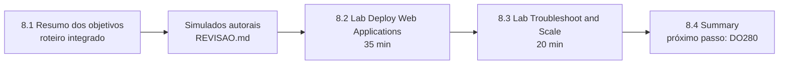

# Capítulo 8 — Comprehensive Review

**Título em português:** Revisão geral
**Status:** ✅ concluído e validado
**Referência:** PDF p. 495–513

## Objetivo do capítulo

Validar o conhecimento adquirido no DO180. O curso apresenta esta revisão como apoio
para quem se prepara para os exames **EX180** e **EX280**.

## Por que este capítulo importa

Os capítulos anteriores ensinaram cada peça. Aqui elas são cobradas **juntas**, por
**especificação**, **sem passos** e **com tempo**. É o formato mais próximo de um
exame prático e o melhor termômetro da sua preparação.

## Seções e atividades (ordem oficial)

| Seção | Tipo | Título original | Material | PDF |
|-------|------|-----------------|----------|-----|
| 8.1 | Revisão | Summary of Learning Objectives | [lição](8.1-resumo-dos-objetivos-de-aprendizagem.md) | p. 496–497 |
| 8.2 | Lab | Deploy Web Applications | [prática](PRATICA-OFICIAL.md#82-lab-deploy-web-applications) | p. 498–506 |
| 8.3 | Lab | Troubleshoot and Scale Applications | [prática](PRATICA-OFICIAL.md#83-lab-troubleshoot-and-scale-applications) | p. 507–512 |
| 8.4 | Summary | Summary | [RESUMO.md](RESUMO.md) | p. 513 |

## Arquivos do capítulo

- [8.1 — Resumo dos objetivos](8.1-resumo-dos-objetivos-de-aprendizagem.md): roteiro integrado dos capítulos 1 a 7.
- [PRATICA-OFICIAL.md](PRATICA-OFICIAL.md): ponte com os dois labs de revisão.
- [REVISAO.md](REVISAO.md): **dois simulados autorais cronometrados** e questões integradas.
- [RESUMO.md](RESUMO.md): síntese final do curso e próximos passos.

## Como usar

1. Releia os `RESUMO.md` dos capítulos 1 a 7.
2. Estude a lição 8.1.
3. Faça os **simulados** da [REVISAO.md](REVISAO.md) em cluster próprio, cronometrando.
4. Faça os labs oficiais 8.2 e 8.3 e compare seu tempo com o de referência.
5. Registre resultados e dicas do `lab grade` no diário.

## Checklist

- [ ] Todos os `RESUMO.md` dos capítulos 1 a 7 relidos
- [ ] 8.1 lida e Parte F respondida
- [ ] Simulado A concluído em até 40 min
- [ ] Simulado B concluído em até 25 min
- [ ] 8.2 Lab `compreview-deploy` aprovado (referência: 35 min)
- [ ] 8.3 Lab `compreview-scale` aprovado (referência: 20 min)
- [ ] Registro no [diário de laboratórios](../../progresso/diario-de-laboratorios.md)

---
[← Capítulo 7](../07-atualizacao-aplicacoes/README.md) | [Índice geral](../../README.md) | [Próximo: 8.1 Resumo dos objetivos →](8.1-resumo-dos-objetivos-de-aprendizagem.md)
