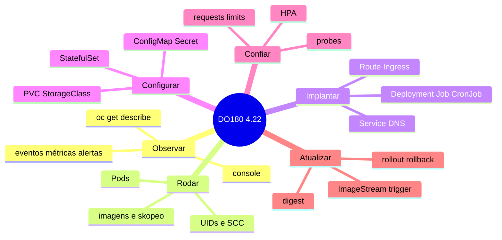

# Resumo — Capítulo 8 e visão final do DO180

Síntese autoral. Correspondência oficial: seção 8.4 (PDF p. 513).

## O curso em uma tabela

| Cap. | Tema | Em uma frase |
|------|------|--------------|
| 1 | Kubernetes e OpenShift | O OpenShift completa o Kubernetes; a console mostra a saúde do cluster |
| 2 | CLI e APIs | Tudo é objeto da API; `oc` consulta, formata e diagnostica |
| 3 | Containers e Pods | Pods são processos isolados com UID da faixa do projeto; diagnostique com logs, exec, cp e port-forward |
| 4 | Deploy e redes | Workloads gerenciam Pods; Services ligam; Routes expõem |
| 5 | Configuração e storage | ConfigMaps, Secrets e PVCs separam configuração e dados do código |
| 6 | Confiabilidade | Probes, requests, limits e HPA mantêm a aplicação disponível |
| 7 | Atualizações | Digests, rollouts, ImageStreams e triggers garantem atualizações reproduzíveis |
| 8 | Revisão | Tudo junto, por especificação e com tempo |

## Mapa final

## 25 comandos essenciais do curso

| # | Comando | Capítulo |
|---|---------|----------|
| 1 | `oc login` / `oc new-project` / `oc project` | 2 |
| 2 | `oc get` / `oc describe` / `oc get -o jsonpath` | 2 |
| 3 | `oc adm top pods -A --sort-by=cpu` | 2, 6 |
| 4 | `oc logs [--previous]` | 3 |
| 5 | `oc exec` / `oc rsh` | 3 |
| 6 | `skopeo inspect` / `oc image info` | 3, 7 |
| 7 | `oc create deployment` | 4 |
| 8 | `oc expose deployment` (Service) | 4 |
| 9 | `oc expose service` (Route) | 4 |
| 10 | `oc scale` | 4 |
| 11 | `oc create secret generic` | 5 |
| 12 | `oc create configmap` | 5 |
| 13 | `oc set env --from secret/... --prefix` | 5 |
| 14 | `oc set volume(s) --add ...` | 5 |
| 15 | `oc get pvc` / `oc get sc` | 5 |
| 16 | `oc set probe --readiness/--liveness` | 6 |
| 17 | `oc set resources --requests/--limits` | 6 |
| 18 | `oc autoscale` / `oc get hpa` | 6 |
| 19 | `oc set image` | 7 |
| 20 | `oc rollout pause/resume/status/undo` | 7 |
| 21 | `oc import-image` / `oc tag` | 7 |
| 22 | `oc set image-lookup` | 7 |
| 23 | `oc set triggers --from-image` | 7 |
| 24 | `oc get endpointslices` | 4 |
| 25 | `oc delete` | 3, 4 |

## Próximos passos

- O curso indica como continuação o **DO280 — Red Hat OpenShift Administration II: Configuring a Production Cluster**: autenticação, RBAC, segurança (SCC), rede avançada, quotas, Operators e manutenção do cluster.
- Para a certificação, confira os objetivos oficiais do **EX280** e use [objetivos-de-aprendizagem.md](../../progresso/objetivos-de-aprendizagem.md) como mapa.
- Revise periodicamente a [consulta rápida](../../consulta-rapida/comandos-oc.md) e a lista de [dificuldades identificadas](../../progresso/dificuldades-identificadas.md).

---
[← Revisão integrada](REVISAO.md) | [Índice do capítulo](README.md) | [Índice geral →](../../README.md)
